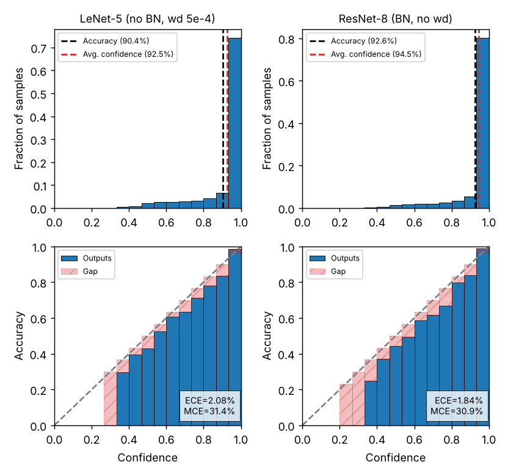
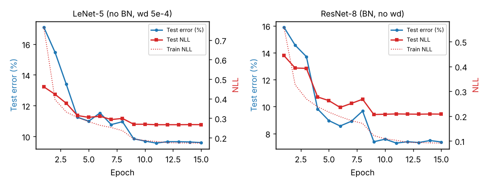
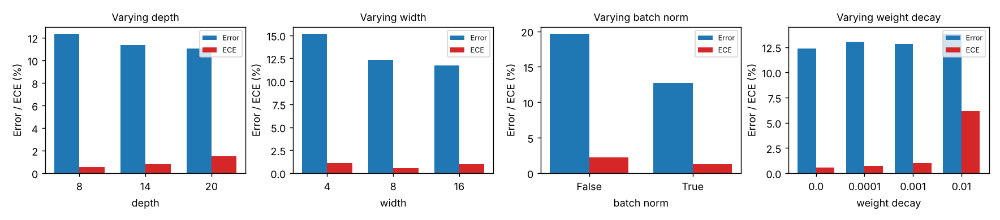
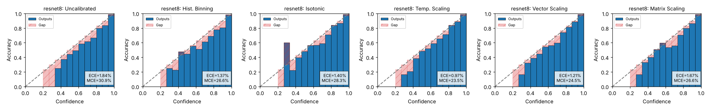

# On Calibration of Modern Neural Networks — a scaled-down reproduction


A CPU-only, small-scale reproduction of

> Chuan Guo, Geoff Pleiss, Yu Sun, Kilian Q. Weinberger.
> **On Calibration of Modern Neural Networks.** ICML 2017.
> [arXiv:1706.04599](https://arxiv.org/abs/1706.04599)

on **Fashion-MNIST**, with every metric, calibration method and plot implemented
from scratch in this repository (only isotonic regression uses scikit-learn's PAV solver).

**Bottom line.** The post-hoc calibration result (Claim 3: temperature scaling is a
simple, accuracy-preserving and competitive calibrator) reproduced qualitatively. The
headline observation that modern networks are *more* miscalibrated than older ones
(Claim 1), the factor study (Claim 2) and the "NLL overfitting" curve did **not**
reproduce at this scale. I think the main reason is that my models were never trained
into the regime the paper studies (near-zero training loss), but I did not test this
explanation directly. Details are in [What reproduced, what didn't, and why](#what-reproduced-what-didnt-and-why).

## The paper's claims tested here

1. **Modern networks are miscalibrated.** A 2016-era ResNet is much more accurate than
   LeNet-5 (1998), but its confidence is much higher than its accuracy (overconfidence).
   LeNet-5 is close to calibrated (paper Fig. 1: CIFAR-100, LeNet ECE ≈ 3%, ResNet-110 ECE ≈ 16.5%).
2. **Things that cause it** (paper Fig. 2): more depth, more width, batch normalization
   and less weight decay all tend to increase ECE, even when they reduce error.
   Related: test NLL can start to rise (overfit) while test error keeps falling (paper Fig. 3).
3. **Temperature scaling works** (paper Table 1): learning one scalar `T` on a validation
   set, `softmax(z / T)`, gives ECE as good as or better than histogram binning, isotonic
   regression, BBQ, vector scaling and matrix scaling, and it cannot change the predicted class.

## Setup

**This is a scaled-down reproduction.** The paper trains ResNet-110 / DenseNet-40 /
Wide-ResNet-32 for hundreds of epochs on CIFAR-10/100, SVHN, ImageNet, and also evaluates
text datasets. Here everything runs on **2 CPU cores, no GPU**. Compute was shared with
another process, so the timings below are rough.

| | This repo | Paper (for comparison) |
|---|---|---|
| Dataset | Fashion-MNIST (28×28 grey, 10 classes) | CIFAR-10/100, SVHN, Birds, Cars, ImageNet, 20NG, Reuters, SST |
| Splits | 55,000 train / **5,000 validation** (held out from the 60k train set, fixed seed) / 10,000 test | 45k/5k/10k on CIFAR |
| "Old" model | LeNet-5 (ReLU, max-pool, no BN), 61.7k params, SGD lr 0.02, wd 5e-4, 15 epochs | LeNet-5 |
| "Modern" model | ResNet-8 (CIFAR-style, 3 stages, width 16, BN), 77.8k params, SGD lr 0.1, **no wd**, 15 epochs | ResNet-110, 500 epochs |
| Optimizer | SGD, momentum 0.9, batch 128, lr ×0.1 at 50% and 75% of training | same schedule shape |
| Augmentation | none | standard crops/flips on CIFAR |
| Seeds | one training seed (0) per configuration | — |
| Compute | full pipeline ≈ 30 min wall clock (claim 1 ≈ 18 min, claim 2 ≈ 12 min, claim 3 < 1 min) | GPUs |

The Fashion-MNIST files are downloaded from the official
[zalandoresearch/fashion-mnist](https://github.com/zalandoresearch/fashion-mnist) repository,
pinned to commit `b2617bb6d3ffa2e429640350f613e3291e10b141`. Each file is checked against a
hard-coded SHA-256 ([`src/calrepro/data.py`](src/calrepro/data.py)).

**Metrics** (paper Sec. 2). Error (%), NLL, **ECE** with M = 15 equal-width bins
`((m-1)/M, m/M]` on the max-softmax confidence, **MCE** (max bin gap), and mean confidence.
For Table 1 I also give a 95% percentile-bootstrap CI for ECE (1,000 resamples of the test
set). This interval covers test-set sampling noise only. It does **not** cover
training-seed variance, which I did not measure.

## Results

All numbers below come from the committed result files in [`results/`](results/) and were
produced by the commands in [How to reproduce](#how-to-reproduce).

### Claim 1: old vs modern network ([`results/claim1/`](results/claim1/))

| Model | Test error (%) | Test NLL | ECE (%) | MCE (%) | Avg. confidence (%) | Final train loss | Final train error (%) |
|---|---|---|---|---|---|---|---|
| LeNet-5 (no BN, wd 5e-4) | 9.60 | 0.267 | 2.08 | 31.4 | 92.5 | 0.173 | 6.28 |
| ResNet-8 (BN, no wd) | 7.37 | 0.208 | 1.84 | 30.9 | 94.5 | 0.092 | 3.00 |



*Confidence histograms (top) and reliability diagrams (bottom) on the test set.*

Both networks are slightly **overconfident**: mean confidence is 1.8 points (ResNet-8: 94.5% vs 92.6%)
and 2.1 points (LeNet-5: 92.5% vs 90.4%) above accuracy, and most reliability bins sit under the diagonal.
The ResNet is more accurate and more confident. However, its ECE is **not** higher than
LeNet's. 1.84% vs 2.08% is inside the bootstrap noise (Table 1 CIs overlap). The MCE values
of about 31% come from low-confidence bins that hold only a handful of samples, so MCE is
very noisy here.



*Test error, test NLL and training NLL per epoch.*

**NLL overfitting** is not visible. After the learning-rate drops, test NLL of both models
stays flat (ResNet-8: 0.207–0.209 over epochs 9–15) while test error also stays flat.
The only non-monotone stretch is ResNet-8 epochs 6–8 at lr 0.1: test NLL rose 0.235 → 0.268
while test error *also* rose (8.56% → 9.67%). That is ordinary high-learning-rate noise,
not the paper's effect.

### Claim 2: factors (paper Fig. 2, heavily reduced) ([`results/claim2/`](results/claim2/))

Each factor was varied one at a time around a base ResNet-8 of width 8 with BN and no
weight decay. Every run used a **10,000-image training subset** for **12 epochs** with a
single seed. The BN comparison uses a plain 6-layer ConvNet (width 16, lr 0.05), as the
paper does. Evaluation is on the full test set.

| Factor | Value | Test error (%) | ECE (%) | Avg. conf. (%) | Final train error (%) |
|---|---|---|---|---|---|
| depth | 8 / 14 / 20 | 12.34 / 11.36 / 11.04 | 0.56 / 0.80 / 1.51 | 87.6 / 89.4 / 90.4 | 10.0 / 8.5 / 7.6 |
| width | 4 / 8 / 16 | 15.16 / 12.34 / 11.74 | 1.11 / 0.56 / 1.00 | 84.3 / 87.6 / 89.2 | 13.3 / 10.0 / 7.1 |
| batch norm (ConvNet) | off / on | 19.64 / 12.72 | 2.19 / 1.28 | 78.5 / 87.0 | 18.8 / 9.7 |
| weight decay | 0 / 1e-4 / 1e-3 / 1e-2 | 12.34 / 13.02 / 12.83 / 13.81 | 0.56 / 0.74 / 1.00 / 6.15 | 87.6 / 86.8 / 86.5 / 80.0 | 10.0 / 11.0 / 10.6 / 12.5 |



How to read this table:
- **Depth**: ECE rises with depth (0.56 → 0.80 → 1.51%) while error falls. This is the
  paper's direction. With one seed and an ECE noise level of a few tenths of a point, it
  is suggestive, not conclusive.
- **Width**: no monotone trend.
- **Batch norm**: the opposite of the paper. The BN-free ConvNet has the *higher* ECE, but
  it is also badly under-trained (18.8% train error) and is mildly **under**confident
  (78.5% confidence vs 80.4% accuracy). The paper's comparison is between two models that
  both fit the training data.
- **Weight decay**: the opposite of the paper. ECE *increases* with weight decay. The large
  value at 1e-2 comes from strong **under**confidence (80.0% confidence vs 86.2% accuracy),
  which is a different failure mode from the overconfidence studied in the paper.

### Claim 3: post-hoc calibration (paper Table 1) ([`results/claim3/`](results/claim3/))

All calibrators are fitted on the 5,000-image validation split. All metrics are computed on
the 10,000-image test set. The logits are the ones from the Claim 1 models.

**Test ECE (%)**, with a 95% bootstrap CI over test samples:

| Model | Uncalibrated | Hist. Binning | Isotonic | Temp. Scaling | Vector Scaling | Matrix Scaling |
|---|---|---|---|---|---|---|
| LeNet-5 | 2.08 [1.66, 2.62] | 1.41 [1.08, 2.02] | 1.56 [1.30, 2.13] | **1.03** [0.81, 1.63] | 1.09 [0.79, 1.67] | 1.46 [1.13, 2.03] |
| ResNet-8 | 1.84 [1.46, 2.29] | 1.37 [1.09, 1.86] | 1.40 [1.16, 1.90] | **0.97** [0.72, 1.46] | 1.21 [0.90, 1.67] | 1.67 [1.37, 2.16] |

**Test error (%)**

| Model | Uncalibrated | Hist. Binning | Isotonic | Temp. Scaling | Vector Scaling | Matrix Scaling |
|---|---|---|---|---|---|---|
| LeNet-5 | 9.60 | 9.70 | 9.56 | 9.60 | 9.54 | 9.60 |
| ResNet-8 | 7.37 | 7.49 | 7.33 | 7.37 | 7.49 | 7.71 |

**Test NLL**

| Model | Uncalibrated | Hist. Binning | Isotonic | Temp. Scaling | Vector Scaling | Matrix Scaling |
|---|---|---|---|---|---|---|
| LeNet-5 | 0.267 | 0.439 | 0.316 | **0.262** | 0.263 | 0.291 |
| ResNet-8 | 0.208 | 0.283 | 0.256 | **0.203** | 0.209 | 0.224 |

The fitted temperatures are **T = 1.124** (LeNet-5) and **T = 1.132** (ResNet-8). Both are
above 1, which means both models were overconfident, but only mildly. The paper's deep
CIFAR networks are far more overconfident and need much larger corrections.



*Reliability diagrams on the test set before and after each method (ResNet-8; LeNet-5 is in
[`fig4_calibrated_lenet5.png`](results/claim3/fig4_calibrated_lenet5.png)).*

What the tables show:
- Temperature scaling gives the lowest ECE and the lowest NLL for both models.
- It leaves the error exactly unchanged. This holds by construction and is checked by a
  unit test.
- The binning methods and matrix scaling can change predictions. Matrix scaling raised
  ResNet-8's error from 7.37% to 7.71%.
- Histogram binning and isotonic regression lower ECE but *raise* NLL. Their piecewise-constant
  outputs are coarse, and NLL penalizes coarse probabilities.
- Caveat on significance: the CIs of the methods overlap. With one training seed and
  starting ECEs of only about 2%, I cannot claim a statistically resolved ranking between
  temperature, vector and matrix scaling. The improvement of temperature scaling over the
  uncalibrated model is the most clear-cut. For LeNet-5 the two CIs do not overlap
  ([0.81, 1.63] vs [1.66, 2.62]). For ResNet-8 they just touch ([0.72, 1.46] vs
  [1.46, 2.29]). These CIs are computed separately for each method, not as paired
  differences.

## What reproduced, what didn't, and why

| Paper finding | Status here | Notes |
|---|---|---|
| Modern nets are overconfident (confidence > accuracy) | **Partially** | Both nets are mildly overconfident (+1.8 / +2.1 points) |
| Modern nets are *more* miscalibrated than LeNet | **Not reproduced** | ECE 1.84% (ResNet-8) vs 2.08% (LeNet-5); the CIs overlap |
| Depth increases ECE | Direction matches (weak) | Single seed, 10k subset, 12 epochs |
| Width increases ECE | Not reproduced | No trend |
| Batch norm increases ECE | Not reproduced (opposite) | BN-free net under-trained and underconfident |
| Weight decay decreases ECE | Not reproduced (opposite) | Large wd led to underconfidence |
| NLL overfits while error keeps decreasing | Not observed | Test NLL flat after lr decay |
| Temperature scaling is best or competitive on ECE | **Reproduced (qualitatively)** | Lowest ECE and NLL on both models |
| Temperature scaling does not change accuracy | **Reproduced** | Exact. Also covered by a unit test |
| Binning methods worse on NLL; matrix scaling can hurt | **Reproduced** | Matrix scaling raised ResNet-8 error by 0.34 points |

**Why Claims 1 and 2 most likely did not reproduce.** These are hypotheses, not tested:

1. **My networks never reached the regime the paper studies.** The paper's miscalibration
   comes from long training past the point where training error reaches about 0%: the
   network keeps lowering training NLL by growing its logits. My ResNet-8 stopped at 3.0%
   train error and 0.092 train loss after 15 epochs. The Claim 2 runs stopped at 7–19%
   train error. In this under-fitted regime the paper's own Fig. 3 also shows a reasonably
   calibrated network. Hundreds of epochs were not affordable on 2 CPU cores. A ResNet-8
   epoch took about 50–70 s on the shared machine.
2. **Fashion-MNIST is easier, and the models are small.** The ResNet-8 here has 78k
   parameters, about the same as LeNet-5 (62k). The paper's ResNet-110 has 1.7M. The
   "capacity gap" between my "old" and "modern" networks is small. Error only fell from
   9.6% to 7.4%.
3. **One seed per configuration.** Test-set bootstrap CIs on ECE are about ±0.4 points.
   Seed-to-seed variance is probably similar or larger and was not measured. Most of the
   Claim 2 differences are within that noise.
4. **Weight-decay / BN sweeps under a fixed short budget mix two effects.** Stronger
   regularization, or no BN, slows training. Within 12 epochs this produces
   **under**confidence, which ECE also penalizes. The paper's sweeps compare converged models.

A more faithful test would train ResNet-8/20 without weight decay for about 100+ epochs to
near-zero training loss, then repeat Claims 1–2 with 3+ seeds. That needs roughly 10–20×
the compute used here.

## How to reproduce

```bash
pip install torch --index-url https://download.pytorch.org/whl/cpu   # or any torch>=2.0
pip install -e ".[dev]"

python -m calrepro claim1     # trains LeNet-5 + ResNet-8 (~15-20 min on 2 cores) -> results/claim1/
python -m calrepro claim3     # fits all calibrators on saved logits (<1 min)       -> results/claim3/
python -m calrepro claim2     # factor sweep, 10 short runs (~12 min)               -> results/claim2/
# or all three in order:
bash scripts/reproduce_all.sh

python -m calrepro plot-claim1   # redraw Fig. 1/3 from the saved logits, no training
python -m calrepro smoke         # 1-epoch end-to-end run on data subsets (~15 s), used in CI
pytest -q && ruff check src tests
```

- Every run is controlled by a JSON config in [`configs/`](configs/).
- Seeds are fixed: the data split uses seed 0, and training uses `torch.manual_seed(seed)`
  and a seeded batch-order generator.
- Calibrator fitting runs single-threaded so that the L-BFGS solutions are bit-reproducible.
- Training is CPU-deterministic for a given thread count and PyTorch build. On different
  hardware or library versions, expect small differences in the last digits.
- The Claim 1 test/validation logits are committed (`results/claim1/logits_*.npz`, about
  0.5 MB each), so Claim 3 can be reproduced without retraining.

## Project structure

```
configs/                 JSON configs for each claim + the CI smoke run
src/calrepro/
  data.py                pinned + SHA-256-verified Fashion-MNIST download, train/val/test split
  models.py              LeNet-5, CIFAR-style ResNet (depth / width / BN), plain 6-layer ConvNet
  train.py               SGD training loop with step schedule, per-epoch test metrics
  metrics.py             ECE / MCE (15 bins), NLL, error, bootstrap ECE CI
  calibration.py         histogram binning, isotonic, temperature / vector / matrix scaling
  plots.py               reliability diagrams + confidence histograms, training curves, factor plots
  experiments.py         drivers for Claims 1-3 (write JSON/CSV/PNG to results/)
  cli.py                 `python -m calrepro {claim1,claim2,claim3,plot-claim1,smoke}`
tests/                   ECE on hand-computed cases, T-scaling argmax invariance, T > 1 on
                         overconfident synthetic data, calibrator sanity checks, model shapes
results/                 committed metrics (CSV/JSON/Markdown), figures (PNG), Claim-1 logits
.github/workflows/ci.yml lint (ruff) + unit tests + smoke run on CPU torch, Python 3.12
```

**Not implemented:** BBQ (Bayesian Binning into Quantiles), which is optional in the paper's
Table 1, and the paper's non-vision (text) experiments.

## License

MIT, see [LICENSE](LICENSE).
